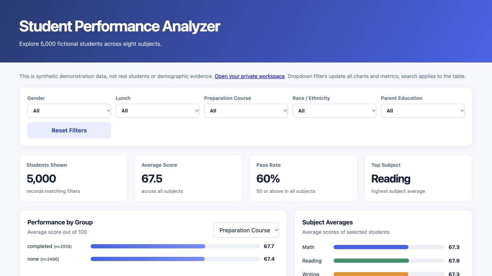

# Student Performance Analyzer

A local student analytics app with a **5,000-student, eight-subject synthetic demo**, a private Django workspace, a normalized SQLite database, a validated CSV reporting tool, and optional read-only agent/MCP integrations.



**All expanded records are fictional.** They are for software demonstrations and testing, not educational decisions or demographic findings. The original 1,000-row CSV remains separate and unchanged.

## Start on your Mac

Python 3.11+ is required. From the project folder:

```sh
python3 -m venv .venv
.venv/bin/python -m pip install -r requirements.txt
.venv/bin/python manage.py migrate
.venv/bin/python manage.py bootstrap_local
.venv/bin/python manage.py changepassword local-admin
.venv/bin/python manage.py runserver 127.0.0.1:8000 --noreload
```

Choose your admin password in the terminal prompt. There is **no default password**: bootstrap creates an account with sign-in disabled until you choose one. After dependencies are installed, double-click **Start.command** to initialize, choose a password if needed, and open the workspace.

- [Public synthetic demo](http://127.0.0.1:8000/)
- [Private workspace](http://127.0.0.1:8000/workspace/)
- [Superuser administration](http://127.0.0.1:8000/admin/)

Keep the server bound to loopback. **Do not serve the repository with `python -m http.server`**: it now contains a private backend. Use the routed Django server. This is a local implementation; public hosting has not been configured or audited.

## Implemented features

- **Public demo:** five background filters, group averages with sample sizes, all-subject metrics, histogram, searchable/paginated table, and reset.
- **Private workspace:** Django login/logout and password change, pseudonymous student creation, per-subject score entry and owner-scoped records. No public signup.
- **Database:** Student, Subject and Score tables, eight seeded subjects, foreign keys, score/uniqueness constraints, migrations, 5,000 seeded students and 40,000 scores for the local account.
- **API:** authenticated and paginated record access; CSRF-protected JSON writes; strict input allowlists. Expiring integration tokens can only read their owner's data.
- **Reporting:** dynamic subjects, grades, rankings, two CSV exports and three charts. Exported text that could execute spreadsheet formulas is neutralized.
- **Integrations:** deterministic RecordsAgent → SummaryAgent pipeline and optional stdio MCP tools; no external LLM/provider account is configured.

## Subjects and data

Math, Reading, Writing, Physics, Chemistry, Biology, Computer Science and History. Scores are whole numbers from 0 to 100, with equal subject weight. The synthetic dataset contains 5,000 unique IDs and ten cohorts. Its overall average is **67.54**. These generated values have no real-world statistical meaning.

| Dataset | Records | Subjects | Purpose |
|---|---:|---:|---|
| `data/synthetic_students.csv` | 5,000 | 8 | Public fictional demo and private seed data |
| `StudentsPerformance.csv` | 1,000 | 3 | Preserved original regression baseline; source/reuse terms remain unverified |

The [manifest](data/manifest.json) records the generation seed and provenance. Regenerate with `python tools/generate_demo.py`. Synthetic data is generated independently; extra scores are never invented for original rows.

CSV inputs require the original five background columns and three base score columns. Additional lowercase subject names ending in ` score` are supported, up to twelve subjects total. Optional `student_id` values must be unique 1–32 character ASCII codes; optional cohorts accept 1–40 ASCII letters/digits/spaces/hyphens/underscores. Required values cannot be blank. Invalid input fails before new reports are written.

## Security protections and limits

Django provides sessions, CSRF and password validation; new password hashes use Argon2. Backend queries enforce record ownership, and admin access requires an active superuser. The staff flag alone is insufficient. JSON fields, score ranges, body sizes, page sizes, searches and rates are bounded. Templates and dashboard text are escaped. Secret/database files have no public route.

Debug is always off. Browser responses include CSP, anti-framing, nosniff and restrictive permissions headers; sensitive routes are not cached. CSP allows inline **styles** for chart bars, but not inline scripts. Rate limits use shared database counters: login 10/IP and normalized account per 15 minutes, APIs/workspace writes 120/IP/minute. Spoofed forwarding headers are ignored.

Local HTTP cookies are intentional for loopback development. Production mode enables HTTPS redirect, HSTS and Secure cookies and requires an independent signing key and explicit hosts. Production hosting, MFA, remote databases, edge protection and backup restoration still need review. A scan cannot guarantee the absence of vulnerabilities.

See the [security audit](docs/security-audit.md), [security policy](SECURITY.md) and [.env.example](.env.example). Environment values are never required in the browser. No external API keys were found in the performed repository scans.

## Offline analysis

```sh
.venv/bin/python student_performance_analyzer.py --input data/synthetic_students.csv --output reports/
# Original three-subject baseline:
.venv/bin/python student_performance_analyzer.py
```

The original sample reports remain in `output/`. Eight-subject examples are in [output/synthetic](output/synthetic/). Both contain student_results.csv, class_summary.csv, subject_averages.png, grade_distribution.png and top_10_students.png. Existing reports in the chosen directory are overwritten on a valid run; a validation failure leaves earlier files untouched.

Grades use the unrounded overall average: A ≥90, B ≥80, C ≥70, D ≥60, E ≥50, otherwise F. The dashboard pass rate requires **at least 50 in every subject**, which differs from a passing overall average. Ranking ties preserve input order.

## API, agents and MCP

See the [API contract](docs/project/05-api-integration.md). Browser writes require a session and CSRF. Integration credentials are deliberately read-only, expire in 1–30 days and are stored only as digests.

```sh
.venv/bin/python -m pip install -r requirements-integrations.txt
.venv/bin/python manage.py create_read_token --owner local-admin --name local-agent --days 1
# Save the shown-once value privately as ANALYZER_API_TOKEN in the process environment.
.venv/bin/python -m integrations.agents
# Optional MCP stdio transport:
.venv/bin/python -m integrations.mcp_server
```

Keep the Django server running in another terminal. The client only accepts loopback origins, does not follow redirects, and limits response size and request duration. Do not commit tokens or paste them into chat. [Agent integration](docs/project/06-agent-integration.md) and [MCP connection](docs/project/12-mcp-connection.md) explain configuration. External services and desktop MCP clients were not silently configured.

## Tests and audit commands

```sh
.venv/bin/python -m pip install -r requirements-dev.txt -r requirements-integrations.txt
.venv/bin/python -m unittest discover -s tests -v
node --test tests/dashboard.test.cjs
.venv/bin/python manage.py test records
.venv/bin/python manage.py check
.venv/bin/python tools/check_production_settings.py
.venv/bin/pip-audit -r requirements.txt
.venv/bin/pip-audit -r requirements-integrations.txt
.venv/bin/bandit -r config records integrations tools analyzer_core.py student_performance_analyzer.py -x records/tests.py,records/test_integrations.py -q
```

Node.js 22+ is required for JavaScript tests. The suite contains 14 analysis/export checks, 8 dashboard checks and 22 Django/security/integration checks. MCP tests explicitly skip if the optional package is absent. The integration test establishes a real stdio MCP session and calls the authenticated HTTP API with a temporary test credential.

[GitHub Actions](https://github.com/kvvraju24/student-performance-analyzer/actions) checks Python 3.11–3.14, Node tests, integrations, known dependency vulnerabilities, source patterns and reachable Git secrets. Action references are pinned to commit IDs; Dependabot checks dependency/action updates weekly. Audit tools are development-only; MCP is optional.

## Project documents

The [15-document index](docs/project/README.md) covers requirements, UI/UX, [architecture](architecture.md), database, API, agents, README, implementation, setup, features, security/authentication, MCP, integration, QA, and debugging. It distinguishes implemented local behavior from future production work.

## Private local state

`.local/` contains the database and a generated signing secret and is excluded from Git. The directory is 0700 and database/secret files are 0600 on this Mac. No password or real bearer token is included in the repository. Run `manage.py purge_expired_security_data` periodically to remove expired sessions, rate buckets and tokens. Stop the server before making a private database backup.

## License

Project code and generated fictional data use the [MIT License](LICENSE). The original dataset's attribution and reuse terms remain unverified and are not established by the code license.
