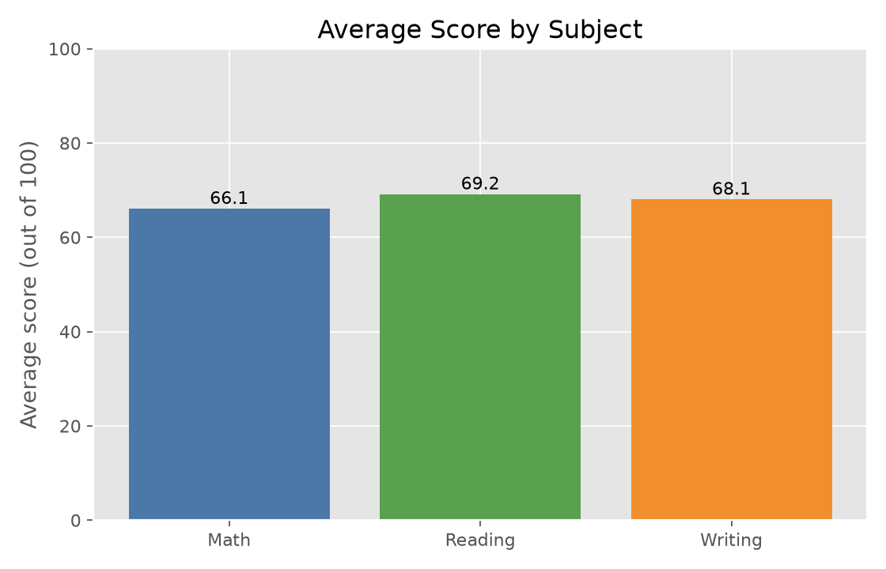

# Student Performance Analyzer

Analyze examination scores with a validated Python reporting tool and an interactive web dashboard. Explore 1,000 student records across math, reading, and writing, then export reproducible reports and charts.


## What it does

- **Python reports:** validate CSV data, calculate totals and grades, rank records, and export two CSV reports and three Matplotlib charts.
- **Interactive dashboard:** filter by five background fields, compare groups with sample sizes, view subject averages and score distributions, and search a paginated table.
- **Quality checks:** 12 Python tests and 7 JavaScript tests cover calculations, invalid input, exports, filters, pagination, reset, and error states. GitHub Actions runs both suites on pushes and pull requests.

## Verified results

| Measure | Included dataset |
| --- | ---: |
| Records | 1,000 |
| Overall average | 67.77 |
| Math average | 66.09 |
| Reading average | 69.17 |
| Writing average | 68.05 |
| Scoring at least 50 in every subject | 812 (81.2%) |

Reading has the highest subject average in this dataset. Group comparisons describe associations and do not establish causes. This is an educational analysis project, not a predictive model.



## Quick start

Requires Python 3.11 or newer and Matplotlib. Automated checks cover Python 3.11, 3.12, and 3.13; the project was also tested locally on Python 3.14.

```bash
git clone https://github.com/kvvraju24/student-performance-analyzer.git
cd student-performance-analyzer
python3 -m venv .venv
source .venv/bin/activate
python3 -m pip install -r requirements.txt
python3 student_performance_analyzer.py
```

On Windows, activate with `.venv\Scripts\activate` and use `python` if `python3` is unavailable.

By default, the analyzer reads the dataset beside the script and refreshes the five files in `output/`. Charts are saved without opening desktop windows. Run `python3 student_performance_analyzer.py --help` for options.

To analyze another compatible CSV and keep the committed sample outputs unchanged:

```bash
python3 student_performance_analyzer.py --input path/to/students.csv --output reports/
```

Custom paths are relative to your current directory. The default input and output paths are relative to the script. Invalid input produces an error identifying the problem and a nonzero exit status, before reports are written. Existing files in the selected output directory are overwritten on a valid run; old reports remain untouched if validation fails.

## Run the dashboard

From the repository folder:

```bash
python3 -m http.server 8000
```

Open [http://localhost:8000/index.html](http://localhost:8000/index.html).

The dashboard fetches `StudentsPerformance.csv`, so serve the folder instead of double-clicking the HTML file. It uses HTML, CSS, and JavaScript without third-party frontend libraries or a backend service.

Dropdown filters update the metrics, charts, and table. Search applies only to the table. Reset clears the dropdown filters and search. Group bars include sample sizes; histogram intervals include the lower bound and exclude the upper bound, except the final interval, which includes 100.

## Input contract

The UTF-8 CSV must have unique headers and these eight columns:

```text
gender,race/ethnicity,parental level of education,lunch,test preparation course,math score,reading score,writing score
```

- Required values must be nonblank; surrounding whitespace in values is removed.
- Scores must be whole numbers between 0 and 100. Blank, decimal, negative, non-numeric, and out-of-range scores are rejected.
- Each row must have the same number of columns as the header.
- Quoted fields, CRLF line endings, and a UTF-8 byte-order mark are supported.
- Empty datasets are rejected. Additional uniquely named columns are allowed but are not included in Python exports.

The dataset contains no student names. Python generates identifiers such as `Student-001` from row order. These identifiers are not permanent student identities.

## Calculation rules

Each subject has equal weight. Total = math + reading + writing; average and percentage = total / 3. Grades use the unrounded average.

| Average | Grade |
| --- | --- |
| 90–100 | A |
| 80 to below 90 | B |
| 70 to below 80 | C |
| 60 to below 70 | D |
| 50 to below 60 | E |
| Below 50 | F |

The dashboard pass rate measures the proportion scoring at least 50 **in every subject**. This differs from receiving a passing overall grade. The dashboard rounds the displayed pass rate to a whole percentage. Tied overall rankings in Python retain input order.

## Tests

The Python suite uses the standard library; no extra test dependency is needed. JavaScript tests require Node.js 22 or newer and use its built-in test runner.

```bash
python3 -m unittest discover -s tests -v
node --test tests/dashboard.test.cjs
```

A shared two-record fixture verifies totals of 270 and 150, averages of 90 and 50, grades A and E, and a class average of 70. The full-dataset regression checks verify all 1,000 records and the subject averages. The Python command-line test generates and inspects all five output files in a temporary directory. Dashboard tests simulate the document; a real browser was also checked manually for loading, filtering, search, and reset.

See the [automated check results](https://github.com/kvvraju24/student-performance-analyzer/actions).

## Structure

```text
student-performance-analyzer/
├── analyzer_core.py                  # CSV validation and reusable calculations
├── student_performance_analyzer.py   # CLI, CSV reports, and plotting
├── StudentsPerformance.csv           # bundled sample data
├── index.html                        # dashboard structure
├── dashboard.js                      # loading, validation, filtering, and rendering
├── style.css
├── tests/
│   ├── fixtures/students.csv          # shared Python/JavaScript example
│   ├── test_analyzer.py
│   └── dashboard.test.cjs
├── .github/workflows/checks.yml
├── docs/dashboard.png
├── requirements.txt
└── output/                           # committed sample reports and charts
```

## Output files

| File in `output/` | Contents |
| --- | --- |
| `student_results.csv` | Required background fields, scores, generated IDs, totals, averages, percentages, and grades |
| `class_summary.csv` | Record count and class/subject averages |
| `subject_averages.png` | Average score by subject |
| `grade_distribution.png` | Record count by grade |
| `top_10_students.png` | Ten highest overall averages |

## Limitations and next steps

- The original dataset source and its reuse terms are not yet documented. The code license does not establish dataset permissions.
- A hosted demo URL has not been verified; the dashboard currently has documented local setup instructions.
- Python and JavaScript validation are separate implementations. Shared fixtures check key results, but they are not a proof of identical handling of every CSV dialect.
- Future work: document dataset provenance, publish a hosted demo, add mobile browser automation, and expand analyses with group counts and uncertainty where appropriate.

## License

Project code is available under the [MIT License](LICENSE). Dataset attribution and reuse terms must be documented separately.
