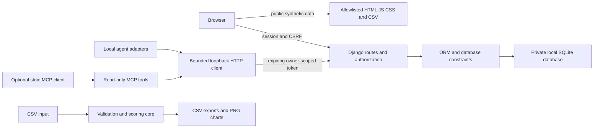

# 03 · Architecture

The project has three local execution paths: a public synthetic dashboard, a private Django application and an offline CSV analyzer. It intentionally has no third-party credentials or cloud resources.

## Data and trust boundaries
The public synthetic CSV contains no real students and is not a view of private tables. Private database files, environment files, Git data and signing keys have no serving route. Requests are checked for authentication, record ownership, method, body limits, validation and CSRF before writes. Admin access requires an active superuser; normal staff flags do not suffice. Read tokens cannot write or expand into global admin scope.

## Design choices
Django supplies authentication, password validators, session rotation, forms, admin and CSRF. Argon2 is selected for new password hashes. SQLite provides a local transactional database; score uniqueness/range constraints add a second boundary beyond forms. Database counters provide process-shared fixed-window rate limiting, unlike per-process memory counters. No reverse-proxy IP headers are trusted. The local server binds only to loopback.

## Extensibility and production boundary
Subject/Score normalization supports the eight seeded subjects without adding score columns to the database. The CSV and public dashboard support up to twelve subjects while preserving three required base subjects. External APIs, LLM providers, PostgreSQL, MFA and hosted deployment are future configuration/implementation work. Production requires a reviewed WSGI/ASGI server, TLS, private credentials, protected backups, monitoring and proxy/IP policy; the local runserver is not a production server. CSP currently allows inline styles only for chart bars, with same-origin scripts.
